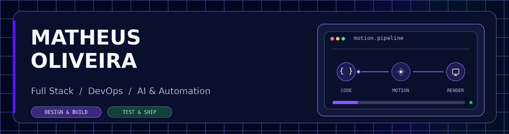

<!--
  Perfil GitHub de Matheus Alves de Oliveira.
  Coloque este README.md na raiz do repositório público MattCorlleone/MattCorlleone.
  A animação depende de assets/profile-motion.gif neste mesmo repositório.
-->

  

<h1 align="center">Olá, eu sou Matheus Alves de Oliveira 👋</h1>

  <strong>Full Stack Developer & DevOps · Software Engineering · AI & Automation · Tech Leadership</strong>

  <a href="https://equilibriumtecnologia.com.br">Equilibrium Tecnologia</a> &nbsp;·&nbsp;
  <a href="https://www.linkedin.com/in/oliveiramatheus14/">LinkedIn</a> &nbsp;·&nbsp;
  <a href="mailto:matheus.oliveira@equilibriumtecnologia.com.br">E-mail</a>

  <a href="#sobre-mim">Sobre</a> &nbsp;·&nbsp;
  <a href="#competências">Competências</a> &nbsp;·&nbsp;
  <a href="#stack">Stack</a> &nbsp;·&nbsp;
  <a href="#produtos-e-sistemas">Produtos</a> &nbsp;·&nbsp;
  <a href="#ia-motion-e-uiux">IA & Motion</a> &nbsp;·&nbsp;
  <a href="#contato">Contato</a>

---

## Sobre mim

Sou desenvolvedor de software com **mais de 8 anos de experiência** na construção de aplicações, integração de sistemas, automação de processos e soluções corporativas. Atuo do levantamento de requisitos à arquitetura, implementação, testes e publicação, combinando **backend, frontend, dados e infraestrutura**.

Sou também **cofundador da [Equilibrium Tecnologia](https://equilibriumtecnologia.com.br)**, onde participo da construção de produtos digitais e soluções sob medida. Ao longo da carreira, exerci **liderança técnica e orientação de colegas**, apoiando decisões de arquitetura, resolução de problemas e acompanhamento de entregas.

Nos meus projetos atuais, exploro a interseção entre **engenharia de software, IA generativa, UI/UX e motion graphics programáticos** — com foco em transformar ideias em experiências úteis, bem construídas e sustentáveis.

> **Minha abordagem:** fundamentos de engenharia primeiro; IA, design e automação como ferramentas para ampliar qualidade, clareza e capacidade de entrega.

## Competências

<table>
  <tr>
    <td width="33%" valign="top">
      <h3>01 · Engenharia</h3>
      
Aplicações Full Stack, APIs, arquitetura, bancos de dados e integrações corporativas.

    </td>
    <td width="33%" valign="top">
      <h3>02 · IA & Automação</h3>
      
LLMs, ferramentas, agentes, automações e pipelines com validação e rastreabilidade.

    </td>
    <td width="33%" valign="top">
      <h3>03 · Produto & UI/UX</h3>
      
Interfaces responsivas, componentes, microinterações, animações e visão de produto.

    </td>
  </tr>
</table>

- **Full Stack:** C#/.NET, TypeScript, Node.js, React, Next.js, Angular e APIs REST.
- **Arquitetura e integrações:** autenticação, autorização, modelagem de dados, modularização, sistemas corporativos e integrações ERP/SAP.
- **DevOps e qualidade:** Git, Docker, CI/CD, testes automatizados, ambientes, deploy e manutenção.
- **UI/UX e motion:** interfaces responsivas, design systems, feedback visual, animações de interface e experiências web com movimento intencional.
- **Liderança:** orientação técnica, colaboração entre pessoas, resolução de impedimentos e acompanhamento de entregas.

## Stack

| Área | Tecnologias e ferramentas |
| :-- | :-- |
| **Frontend & UI** | React, Next.js, Angular, React Native, TypeScript, JavaScript, Tailwind CSS, shadcn/ui |
| **Backend** | C#/.NET, Node.js, Express, Python, Java, Prisma, APIs REST |
| **Dados** | PostgreSQL, Supabase, SQL Server, MySQL, MongoDB, SQL, migrações e RLS |
| **DevOps & Cloud** | Docker, GitHub Actions, Vercel, Azure, Cloudflare, Linux, VPS, CI/CD |
| **Testes & Qualidade** | Playwright, Vitest, TypeScript, ESLint, Zod, validações automatizadas |
| **IA & Ferramentas** | Claude Code, Codex, Cursor, Ollama, LiteLLM, integração de LLMs, experimentos com MCP |
| **UI/UX & Motion** | Design responsivo, componentes, GSAP, Motion, HTML/CSS/SVG, FFmpeg, captura por frames |

<strong>Outras experiências e integrações</strong>

- Integrações com **SAP/ERP**, sistemas corporativos e APIs de terceiros.
- **SSRS**, **Power BI** e consultas/modelagem com **SQL Server**.
- Pagamentos, frete e comunicação transacional: **Mercado Pago, Stripe, Melhor Envio e Resend**.
- Métricas e experiência web: **GA4, GTM, Microsoft Clarity, Core Web Vitals, SEO técnico e otimização de imagens**.
- Desenvolvimento com testes de aceitação, documentação, análise de requisitos e revisão técnica.

---

## Produtos e sistemas

Produtos da <strong>Equilibrium Tecnologia</strong> e iniciativas que envolvem arquitetura, engenharia e evolução de software. Os estágios são informados para diferenciar entregas, desenvolvimento e planejamento.

<table>
  <tr>
    <td width="50%" valign="top">
      <h3>Gestão Empresarial</h3>
      
<em>Sistema modular · Desenvolvimento / implantação por cliente</em>

      
Gestão de clientes, contatos, leads, propostas, pipeline comercial, recorrências e controles financeiros.

      
<code>React</code> <code>TypeScript</code> <code>Supabase</code> <code>PostgreSQL</code>

      
Foco em regras de acesso, testes e individualização por empresa.

    </td>
    <td width="50%" valign="top">
      <h3>Agile Lite</h3>
      
<em>Plataforma SaaS · Sistema em evolução</em>

      
Organização de projetos, atividades e equipes, com fluxos de trabalho, prioridades, responsáveis e acompanhamento de entregas.

      
Foco em experiência de uso, organização e evolução por integrações.

    </td>
  </tr>
  <tr>
    <td valign="top">
      <h3>Equilibrium PDV</h3>
      
<em>Ponto de venda white-label · Desenvolvimento</em>

      
Gestão comercial com produtos, estoque, vendas, papéis, permissões e caixa, em arquitetura preparada para dados isolados por cliente.

      
<code>Next.js</code> <code>Node.js</code> <code>Express</code> <code>Prisma</code> <code>PostgreSQL</code>

    </td>
    <td valign="top">
      <h3>Catálogo Digital</h3>
      
<em>Solução comercial · Em desenvolvimento</em>

      
Produto concebido a partir de uma necessidade real de negócios: facilitar a gestão de catálogos e simplificar os fluxos de integração com o ecossistema Meta.

    </td>
  </tr>
  <tr>
    <td valign="top">
      <h3>Agenda Equilibrium</h3>
      
<em>Agendamentos · Em desenvolvimento</em>

      
Plataforma para organização de agendas e serviços, considerando personalização, integrações e modelos de operação por negócio.

    </td>
    <td valign="top">
      <h3>Equilibrium Conecta</h3>
      
<em>Negócios & comunidade · Planejamento</em>

      
Iniciativa de conexão entre negócios locais e comunidade, com estruturação de funcionalidades, planos e regras de utilização.

    </td>
  </tr>
</table>

## IA, Motion e UI/UX

### Motion graphics programáticos

Crio peças e vídeos a partir de **animações web**, usando **GSAP/Motion, Playwright e FFmpeg**. O pipeline explora captura determinística de frames, testes visuais, sincronização entre narração e elementos na tela, geração de capas e renderização automatizada.

Também trabalho com princípios de **motion aplicado a UI/UX**, como transições com propósito, hierarquia visual, ritmo, easing, feedback de interação e consistência entre formatos. A evolução do pipeline contempla conteúdos em múltiplas proporções para diferentes plataformas.

O banner deste README é um exemplo de motion graphics discreto, renderizado como GIF para compatibilidade com o GitHub.

### Agentes e fluxos com IA

Experimento com **LLMs locais e remotos**, integrações de APIs, ferramentas de desenvolvimento assistido e padrões de orquestração de agentes. Investigo o uso de **MCP** e de automações com foco em soluções verificáveis, com testes, documentação e responsabilidade sobre o código gerado.

### Laboratório de produtos

Mantenho protótipos e estudos relacionados a **gestão de investimentos**, **processamento de conteúdo com IA** e produtos digitais para pequenos negócios. Os projetos estão em diferentes estágios de exploração e desenvolvimento.

---

## Projetos para clientes

Participo de projetos digitais de empresas como **[ARQ 7 Decorações](https://arq7decoracoes.com.br/)**, **[J&E Embalagens](https://www.jeembalagens.com.br/)**, **[M&S Escovas Industriais](https://www.msescovasindustriais.com.br/)**, **[Quincolor](https://www.quincolor.com.br/)**, **[Patrícia Amorim Designer](https://www.patriciaamorimdesigner.com.br/)** e **Heavy Lift**.

Entre os desafios recorrentes estão **sites e experiências web**, integrações e formulários, CMS, SEO técnico, acessibilidade, métricas, performance, ambientes de desenvolvimento e publicação.

**Outlet do Chinelo:** desenvolvimento de e-commerce e gestão operacional com catálogo, variações de produto, estoque, usuários e integrações comerciais, em módulos frontend e backend.

<strong>Sobre repositórios e demonstrações</strong>

Parte dos sistemas próprios e trabalhos comerciais está em **repositórios privados**. Posso apresentar decisões de arquitetura, fluxos, demonstrações e detalhes técnicos observando a confidencialidade e as permissões de cada projeto.

## Como gosto de trabalhar

Gosto de unir **clareza de requisitos, boa arquitetura, testes, UI/UX e entregas consistentes**. Uso IA como aceleradora, sem abrir mão de entender, validar, documentar e manter o código. Acredito em soluções simples quando possível e robustas quando necessário.

---

## Contato

  <a href="https://github.com/MattCorlleone">GitHub</a> &nbsp;·&nbsp;
  <a href="https://www.linkedin.com/in/oliveiramatheus14/">LinkedIn</a> &nbsp;·&nbsp;
  <a href="https://equilibriumtecnologia.com.br">Equilibrium Tecnologia</a> &nbsp;·&nbsp;
  <a href="mailto:matheus.oliveira@equilibriumtecnologia.com.br">E-mail</a>

  <strong>Tecnologia com propósito · Código com qualidade · Evolução contínua</strong>

  

